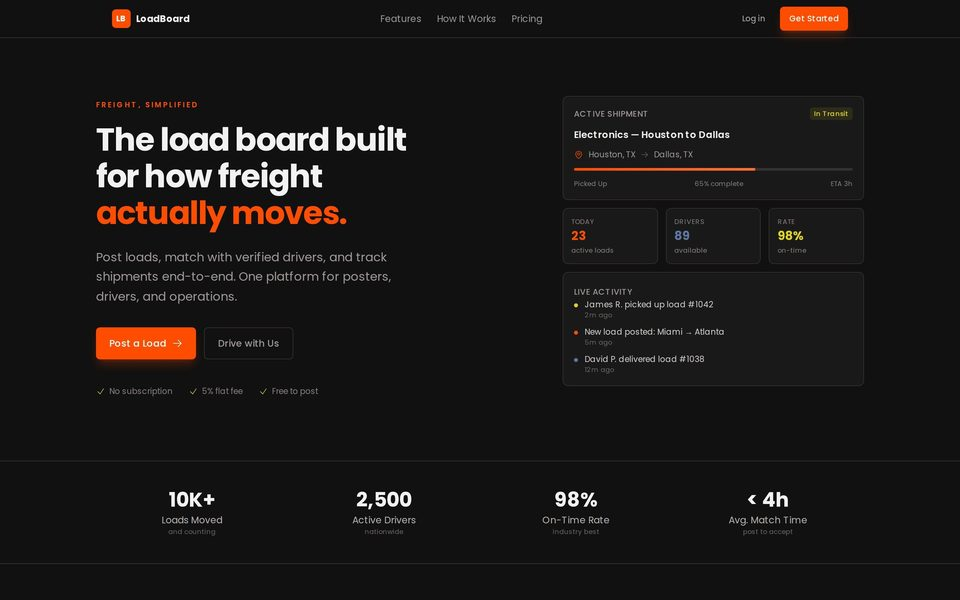
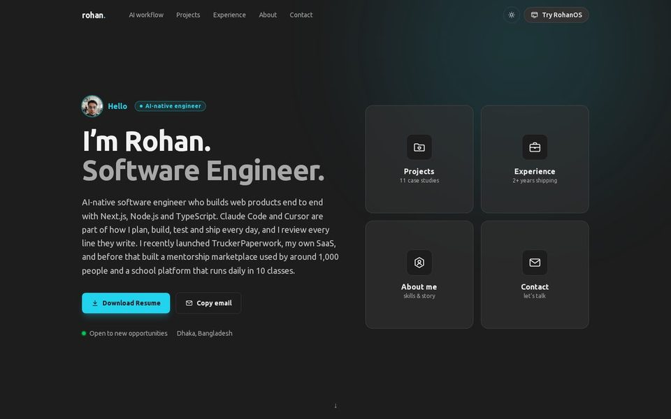
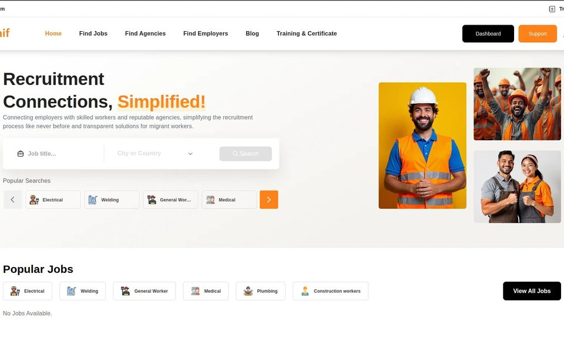
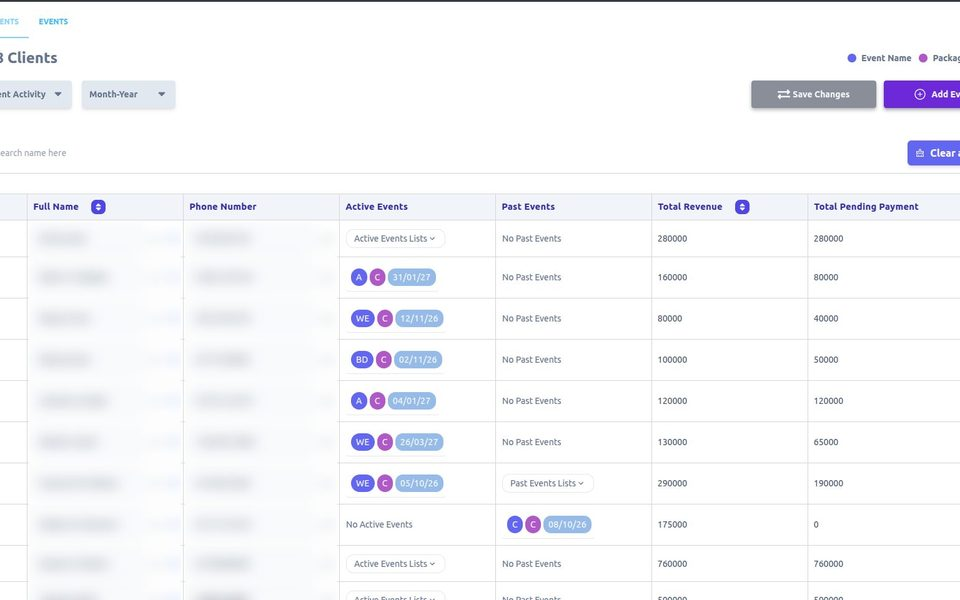
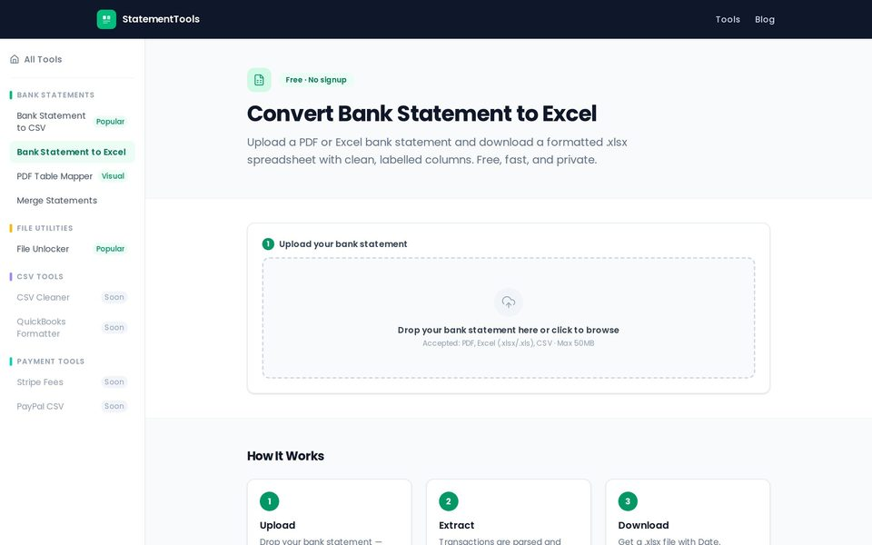
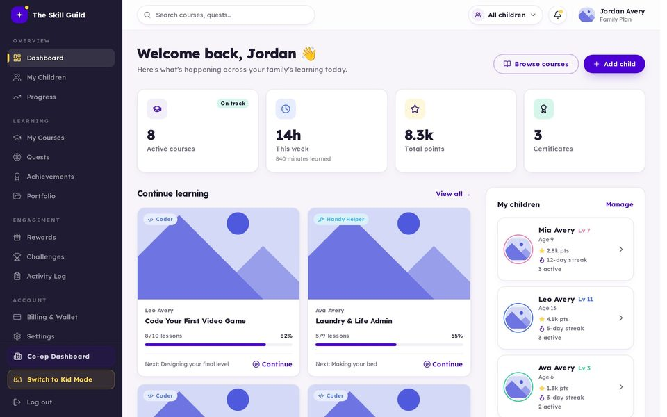
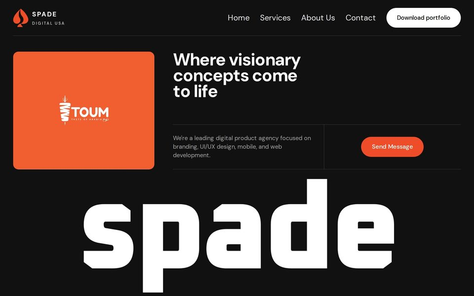
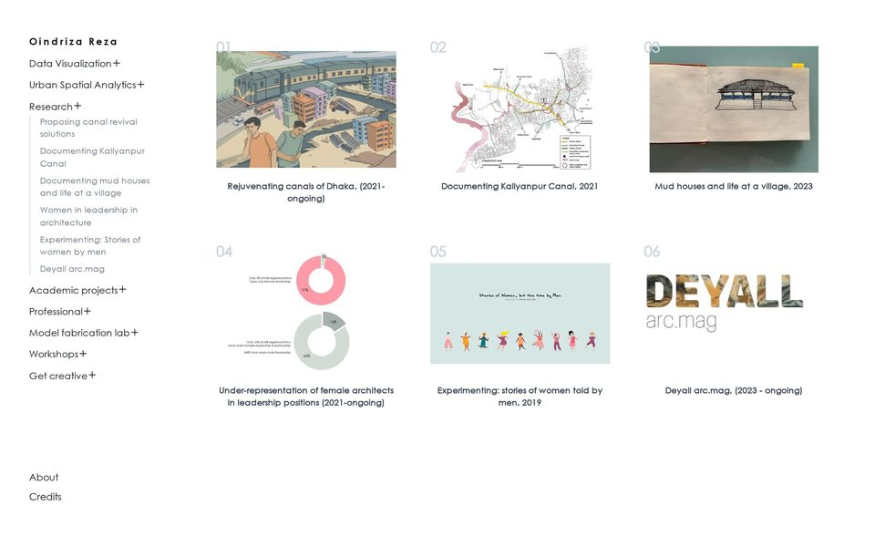

  

  
  
  
  

## 👋 Hey, I'm Rohan

I'm an AI-native software engineer who builds web products end to end with **Next.js, Node.js and TypeScript**: Postgres schemas, APIs, AWS pipelines, payments, and the dashboards people actually use every day. Claude Code and Cursor are part of how I ship, and I review every line.

🌐 **See everything at [rohanships.com](https://rohanships.com/)**: a clean Pro mode, or RohanOS if you're curious.

- 🚚 **Now:** building and running [**TruckerPaperwork**](https://www.truckerpaperwork.com/), my own SaaS for truck drivers
- 🎧 **Before:** two years at [Spade Digital](https://spadedigital.com/) building [Barnyard Recs](https://www.barnyardrecs.com/) end to end (front end, back end and AWS), a mentorship marketplace now earning **$50k+ ARR** with around 1,000 active users
- 🏫 **On the side:** a school platform that runs daily in 10 classes at [Sonamukh Smart Academy](https://www.sonamukh.org/)
- 💼 **Open to** software engineering roles and selected freelance work

## 🛠️ Featured work

<table>
  <tr>
    <td width="50%" valign="top">
      
      <h3>TruckerPaperwork</h3>
      <b>Live · my product</b>
      
Mobile-first PWA: truckers scan paperwork, merge it into one clean PDF and send it to brokers from their own Gmail. Lemon Squeezy subscriptions, Gmail OAuth, on-device scanning, Postgres row-level security, end-to-end tests in CI.

      <code>Next.js</code> <code>Supabase</code> <code>Lemon Squeezy</code> <code>Gmail API</code> <code>Playwright</code>
    </td>
    <td width="50%" valign="top">
      
      <h3>Barnyard Recs</h3>
      <b>Live · $50k+ ARR · ~1,000 users · <a href="https://spadedigital.com/">Spade Digital</a></b>
      
Electronic-music mentorship marketplace I built end to end: front end, back end and AWS hosting. Timezone-aware booking, automatic Stripe Connect payouts when instructors hit their monthly goals, a transaction ledger that traces every sale, refund and payout, video reviews transcoded with AWS MediaConvert, live chat and video calls.

      <code>Next.js</code> <code>Prisma</code> <code>AWS</code> <code>Stripe Connect</code> <code>CometChat</code>
    </td>
  </tr>
  <tr>
    <td width="50%" valign="top">
      
      <h3>LoadBoard</h3>
      <b>Client MVP · <a href="https://loadboard-track.vercel.app/">live demo</a></b>
      
Freight load board for shippers, drivers and admins: job approval flow, proof-of-delivery uploads, invoices, ratings and live driver tracking on a map.

      <code>Next.js</code> <code>Express</code> <code>Prisma</code> <code>PostgreSQL</code> <code>Mapbox</code>
    </td>
    <td width="50%" valign="top">
      
      <h3>Sonamukh School Management</h3>
      <b>Live · used daily in 10 classes</b>
      
Bilingual school site with dashboards for operators, teachers, students and parents: online admissions, attendance, progress reports and publishing, replacing paper records.

      <code>Next.js</code> <code>Prisma</code> <code>PostgreSQL</code> <code>Supabase</code>
    </td>
  </tr>
  <tr>
    <td width="50%" valign="top">
      
      <h3>Doctor Tracker</h3>
      <b>Open source · <a href="https://github.com/SadeeMsr/doctor-tracker-web">web</a> · <a href="https://github.com/SadeeMsr/doctor-tracker-api">api</a></b>
      
Clinic admin portal built like production software: an Express 5 + MongoDB API in Clean Architecture layers, secure sessions, and 140 automated tests.

      <code>Next.js 16</code> <code>Express 5</code> <code>MongoDB</code> <code>Vitest</code>
    </td>
    <td width="50%" valign="top">
      
      <h3>rohanships.com</h3>
      <b>Live · open source · <a href="https://github.com/SadeeMsr/portfolio">code</a></b>
      
My portfolio in two moods: a clean Pro mode with device-framed case studies, and RohanOS, a tiny operating system with draggable windows, a working terminal and a mini-game.

      <code>Next.js 16</code> <code>React 19</code> <code>Tailwind 4</code>
    </td>
  </tr>
</table>

### More work

<table>
  <tr>
    <td width="33%" valign="top">
      
      <b>Wozaif</b> UAE recruitment platform for migrant workers, employers and agencies. Built at Doodle Inc. on AWS serverless. 
      <code>Next.js</code> <code>GraphQL</code> <code>AppSync</code> <code>DynamoDB</code>
    </td>
    <td width="33%" valign="top">
      
      <b>RP Billing</b> Billing and accounting system for a 100-person photography company: every booked event becomes invoices and ledgers. 
      <code>React</code> <code>Redux Toolkit</code> <code>Tailwind</code>
    </td>
    <td width="33%" valign="top">
      
      <b>Statement Tools</b> Bank-statement PDFs to clean Excel and CSV, plus PDF unlocking. 
      <code>Next.js</code> <code>pdf-lib</code> <code>SheetJS</code>
    </td>
  </tr>
</table>

### Design and front-end showcase

<table>
  <tr>
    <td width="33%" valign="top">
      
      <b>The Skill Guild</b> Front-end MVP of a homeschool platform with parent, kid, co-op and admin views, plus 3D scenes. <a href="https://homeschool-app-main.vercel.app/">Live demo</a>
    </td>
    <td width="33%" valign="top">
      
      <b>Spade Digital design showcase</b> My scroll-driven animation concept for the agency site. The real company site is <a href="https://spadedigital.com/">spadedigital.com</a>. <a href="https://spade-digital-usa.vercel.app/">Live demo</a>
    </td>
    <td width="33%" valign="top">
      
      <b>Oindriza Reza</b> Portfolio site for an architect and urban researcher.
    </td>
  </tr>
</table>

Most of my client work lives in private repos. Happy to walk you through the code on a call.

## 🧰 Tech I use

  
   
  

**Also:** Stripe · Lemon Squeezy · Clerk · Gmail API (OAuth) · TanStack Query · PWAs · Playwright · Vitest · PostHog · AWS MediaConvert, S3, Lambda, AppSync

## 📈 Career, as release notes

| Version | Role | When |
| --- | --- | --- |
| `v3.0` | **Software Engineer**, Independent (TruckerPaperwork, client MVPs) | Aug 2026 – now |
| `v2.0 LTS` | **Software Developer**, [Spade Digital](https://spadedigital.com/) | Jun 2024 – Jul 2026 |
| `v1.0` | **Software Development Intern**, Doodle Inc. | Feb – Jun 2024 |
| `v0.x beta` | **B.Sc. Computer Science**, Independent University, Bangladesh | 2019 – 2024 |

## 📫 Let's talk

The fastest way to reach me is email: **rohan.devwhiz@gmail.com**. Everything else lives at **[rohanships.com](https://rohanships.com/)**.

Fuelled by coffee, strict TypeScript and well-named variables.

